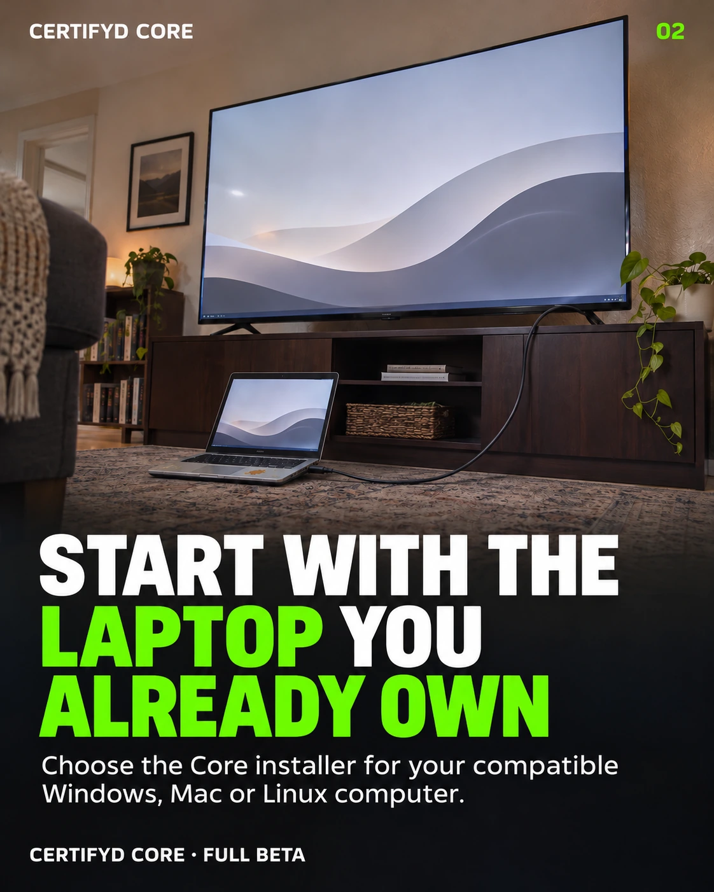
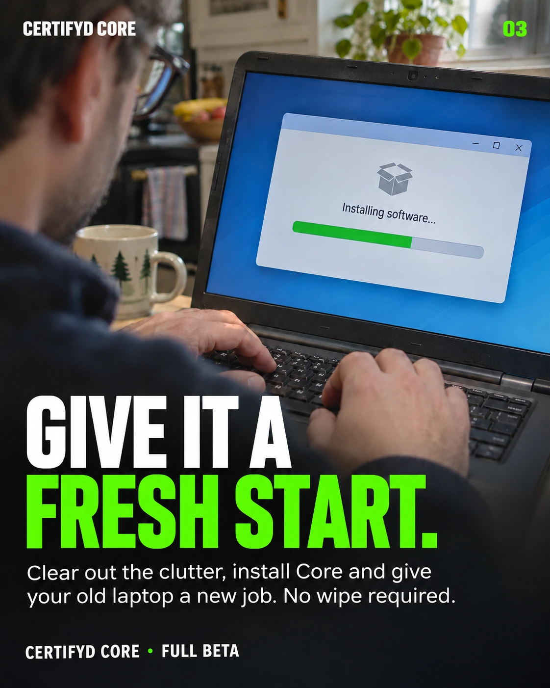
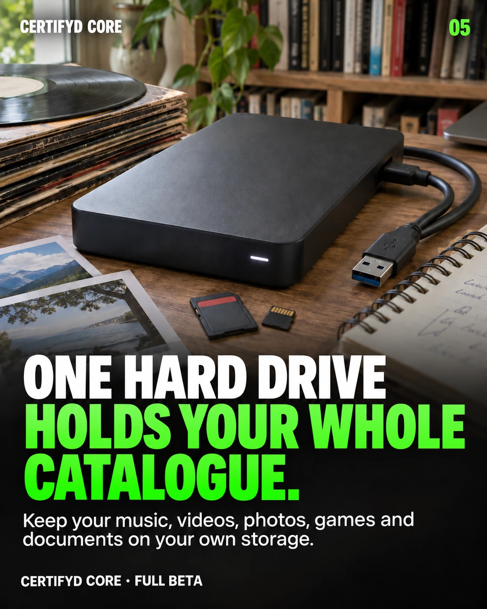
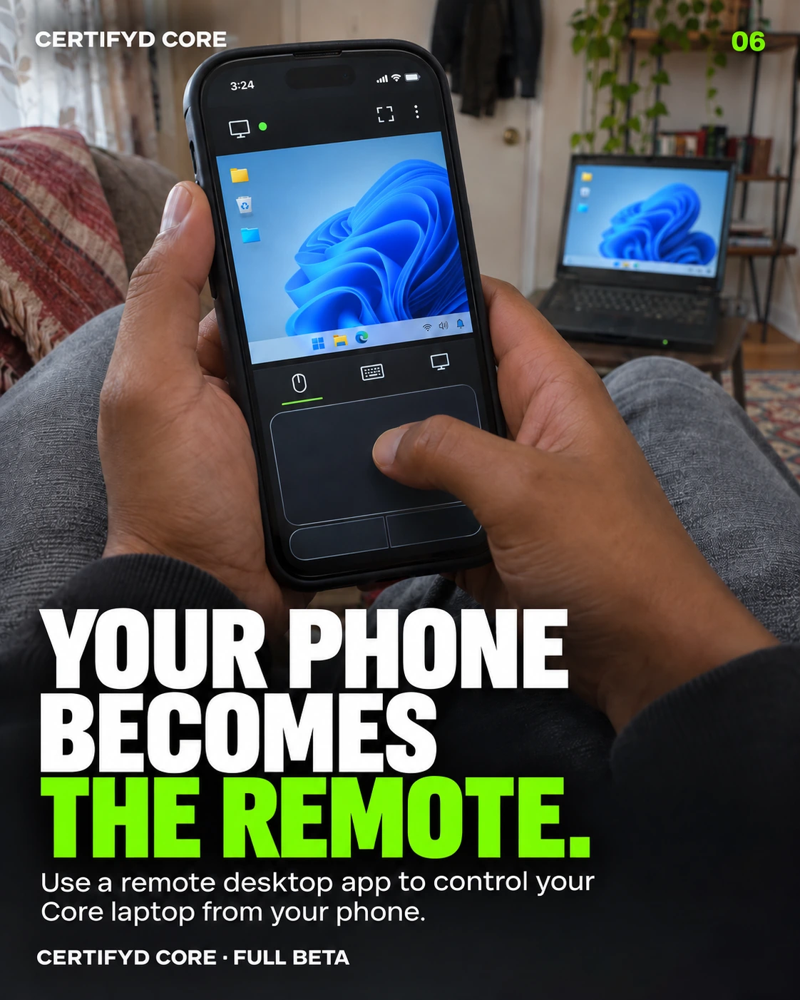

# Your Old Laptop Could Run Your Creator Business

There is probably a laptop in your house that still works. It became the spare when you upgraded, or slowed down enough that you stopped reaching for it. Now it sits in a drawer while you pay other companies to hold the work you made on a computer just like it.

That old machine might have another job. With compatible hardware and an operating system supported by Certifyd Core, it can become part of the infrastructure behind your creative business. The question is what you want your computer to do once the work is ready to leave the editing screen.

## Stop Paying for a Creator Platform

Creators pay for convenience in all kinds of ways: subscriptions, sales fees, storage plans and the time spent moving between accounts. Those services can be useful. But when your identity, catalogue and business exist inside someone else's account system, the choices available to you depend on how that company runs it.

Certifyd Core gives creators a way to operate more of that infrastructure themselves. It puts a local environment for identity, work records and publishing on a computer they control. Running it carries responsibilities, but it also changes who operates this part of the business.

Repurposing a laptop is a practical starting point. You can explore that approach with equipment you already have before deciding whether you need a dedicated machine.

## Start With the Laptop You Already Own

Start by checking the machine, rather than assuming every old laptop will work. The operating system, processor, available storage and condition of the hardware all matter. Choose the appropriate package from the [Certifyd Core downloads page](https://certifyd.me/downloads/) and follow the [installation guide](https://certifyd.me/core/guide/).

Core has published packages for Windows, macOS and Linux. A spare compatible laptop can give you a place to learn the software without turning your main creative workstation into the machine you depend on for public access.

A bigger screen can make setup more comfortable, but connecting a television is optional. The useful part is the computer running Core.

## Give It a Fresh Start

Giving a computer a fresh start does not have to mean wiping its drive. Remove software you no longer need, make room for your work and check that the operating system is maintained. Back up anything important before making changes.

Then install Core, create your first owner and open the local dashboard. If the computer already has a Core installation, use the existing owner rather than starting another identity unnecessarily. Follow the current guide for the package you downloaded.

The aim is a machine you understand and can maintain. A spare laptop is useful only if it reliably does the job you give it.

## Your Own Creator Server

A creator's computer can do more than record audio, edit photographs or export video. It can also run the systems that help present and publish that work. Core connects the creator's identity with their catalogue and publishing activity in an environment they operate.

There is an important step between installing software and making work available to fans. Core's administrative dashboard is private to the computer by default; public sharing needs its own configuration. The [Core installation guide](https://certifyd.me/core/guide/) explains that distinction.

Once you choose to serve work publicly, the computer and its configured public connection need to remain available. That means thinking about power, connectivity and sleep settings. Operating your own infrastructure gives you control alongside the responsibility to keep it running.

## One Hard Drive Holds Your Whole Catalogue

Creative work has a way of spreading across devices and folders. Finished tracks sit beside photographs, artwork, video exports and documents, while an older project remains on a drive you have not opened in months. Bringing those files into an organised collection makes them easier to work with.

Local storage gives you somewhere to keep that collection under your control. How much fits on one drive depends on its capacity and the size of your files; a video catalogue has different needs from a collection of documents. An external drive can add room when the laptop's internal storage is limited.

Core supports records for different kinds of digital work, so your catalogue can extend beyond a single medium. Keep a separate backup of important files as well. A drive holding the collection is still one drive.

## Your Phone Becomes the Remote

You do not need to sit in front of the laptop every time you want to control it. A compatible remote desktop app can let you access the computer from your phone. The laptop continues running the software while the phone provides the screen and controls.

This is a separate remote desktop setup, rather than a native Core phone remote. Choose a tool appropriate for your operating system and configure authenticated access. You do not need to make the private Core dashboard public to use this approach.

It is a small convenience that makes a spare computer more useful. The machine can stay in its place while you reach for the device already in your pocket.

## Your Work, Without the Platform in the Way

The purpose of this setup reaches beyond finding a use for old hardware. It gives creators a practical way to explore publishing from infrastructure they operate. Fans can discover work through [Certifyd Discovery](https://fan.certifyd.me/), while the creator runs their own Core.

Our [Can It Run Core? demonstration](https://certifyd.me/blog/can-it-run-core-your-computer-your-network/) follows that relationship from everyday computers to published work and a real purchase. It shows why the machine matters: there is a connection between the creator's own setup and the fan's access to their work.

Your computer already helped you make something. It can have a role in what happens next, too.

Certifyd Core is in full beta. [Choose the download for your compatible computer](https://certifyd.me/downloads/) and give it a new job.

Run it. Sell it. Get paid.
