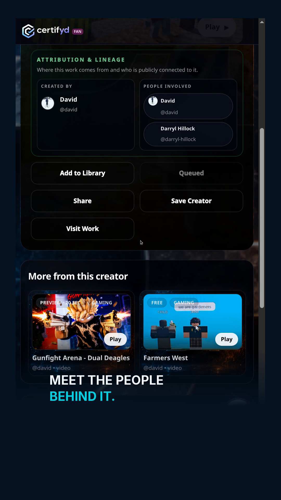

# Discover Creative Work Through the People Behind It

Sometimes the most interesting discovery happens after you've found something you like. You hear a song and wonder who else worked on it. You enjoy a video, notice a contributor's name, and want to see what they've made with other people.

For a creator, those credits carry part of your creative life: the people you've worked with and the projects that brought you together. For someone discovering your work, they can offer a reason to keep exploring.

[Certifyd Fan](https://fan.certifyd.me/) supports that kind of exploration where the public records provide the connections. A work can lead to a contributor, their creator profile and another collaboration.

## From a game video to another collaboration

A product demonstration recorded on **November 25, 2026** followed that journey through **Farmers East**, a gaming video by **David** used in earlier Certifyd testing.

Opening **Attribution & Lineage** revealed David and **Darryl Hillock** among the people involved. Following Darryl's contributor link opened his public creator profile. Its **Collaborations** section included both Farmers East and **I Love Certifyd**: another work to explore through someone connected to the first.

The useful discovery wasn't just another video. It was a person whose creative connections gave the viewer somewhere else to go.

<figure>
  
  <figcaption>November 25, 2026 — a recorded product demonstration from earlier testing. Select the image for the full-size view.</figcaption>
</figure>

## The people recorded alongside the work

Two current public works show how contributor information can carry across projects. Checked on **November 27, 2026**, **[I Love Certifyd](https://certifyd.blessedrthe.fyi/buy/cmuuugt8w0005uwmw93s8her2)** and **[Margaret's Place](https://certifyd.blessedrthe.fyi/buy/cmpz4zbos000duwfslk6gi0mr)** both name **Blessedrthe** as creator. Each lists **darrylhillock** and **Blessedrthe** as writers, with a recorded **50%** allocation apiece.

Seeing the same contributor labels on two works gives a viewer context that a title or thumbnail alone cannot provide. These records show the shared credits and allocations. Their contributor entries currently have no profile links, so they do not provide the complete click-through journey shown in the earlier demonstration.

## When a credit leads somewhere

A [public Certifyd profile](/profile/) brings a creator's identity, selected work and official links together. Where a work links to a contributor's profile and that profile lists collaborations, a viewer can follow the connection into another project.

As more works have linked creator profiles and available collaboration records, that could open more routes through the network. Someone might arrive for one work and stay to explore a collaborator's other projects. The connection becomes another way to choose what to discover next.

Fan currently shows contributor information and supports navigation where those links exist. The broader possibility depends on creators making those connections public and keeping their destinations available.

## A note on the examples

The November 25 Farmers East demonstration shows a real product workflow, although its contributor records and links have since changed. The current examples demonstrate recorded credits and splits, but not a complete clickable discovery journey.

These records document attribution; they don't independently establish legal ownership, payments or royalties received.

## Give people another way into your work

[Certifyd Core](/core/) provides the creator-operated publishing infrastructure behind supported work records and profiles. **Fan is a separate discovery application**, bringing together eligible public work from configured creator origins.

If you're preparing your own work, the [Core walkthrough](/core/guide/#works) covers work records, and the [split setup guide](/core/guide/#splits) explains the supported contributor-agreement workflow. Publication, public sharing and discovery are separate steps; sharing does not guarantee inclusion or an audience.

A viewer may come for a particular work. A useful credit can give them a reason to meet the people behind it—and see what else connects them.
